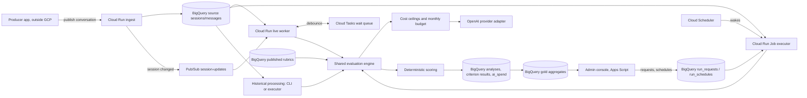

# Architecture and boundaries

### Live event contract
`{event_id, organization_id, workspace_id, session_id, source_updated_at, source_version}`. Events are emitted by the upstream ingestion pipeline *after* source data is queryable; dedupe and eventual consistency must be handled. Alternative: partition-pruned watermark scanner on Scheduler with overlap and checkpoints.

### Runtime isolation
Cloud Run services use dedicated service accounts. BigQuery row policies/authorized views can supplement but do not replace application tenant predicates. Separate billing/quotas per tenant in application accounting.

### State
BigQuery is analytical, not a low-latency transactional queue. Use Pub/Sub for delivery; for debounce consider Cloud Tasks named tasks or lightweight external state, benchmark before choosing. No unbounded MERGE per message. Use append-only output + deduplicated latest views.

## The live path as implemented (verified in dev, 2026-11-01)
1. **Producer** (outside this repository: the upstream ingestion pipeline, or the conversation ingest service after it stores a conversation) publishes a `SessionUpdateEvent` (`contracts/session-update.schema.json`) to the Pub/Sub topic `sci-dev-session-updates`, after the data is queryable. BigQuery row-insert events are never assumed.
2. **Push subscription** (OIDC token of a dedicated identity) delivers it to the Cloud Run service `/pubsub/push`. The worker verifies the token, validates the event (malformed: 400), answers 503 while AI is off, rejects a tenant that is not in the allowlist (403), and **schedules a Cloud Tasks task** named from tenant + session + the window in which the notice ARRIVES (not the `source_updated_at` the producer wrote: a burst of notices stamped minutes apart is still one conversation, and it used to become one task and one paid AI call per stamp). Every notice of a window shares that one task, which runs one wait after the window ends (between the wait and the wait plus a window), so two tasks of a session are always a whole window apart and never evaluate the same conversation at the same time. A redelivery in a later window makes another task that ends as `DUPLICATE_CONTENT`, at no AI cost. Failed deliveries are retried 5 times and then parked in the dead-letter hold (7 days).
3. **Cloud Tasks queue** (5 dispatches/s, 5 concurrent, 8 attempts, backoff 10 to 300 s) calls `/tasks/evaluate` after the wait (60 s in dev, 120 s by default).
4. **Evaluation** (`LiveProcessor`): loads the published rubric (or routes the session to one), reads only that session from BigQuery (bounded, tenant-filtered; "source behind the event" becomes a retry), **skips an unchanged content** (hash against the stored analyses, no AI cost: `DUPLICATE_CONTENT`), applies the per-session rate limit and the **monthly budget** (month-to-date spend from the ledger plus the worst case of this call), calls the engine (OpenAI, model from the closed catalog), and **writes the analysis and the criteria** to BigQuery (load jobs, deterministic job ids). Every handled event leaves a row in `analysis_runs` with its outcome (`EVALUATED`, `DUPLICATE_CONTENT`, `BUDGET_BLOCKED`, `RATE_LIMITED`, `TOKEN_LIMIT`, `NO_MESSAGES`, `SESSION_NOT_FOUND`, `ROUTED_SKIP`); failures go to `run_failures`.
5. **Observability**: structured logs (`event_scheduled`, `evaluation`, `live_event`, `task_retry`), alert policies for failures, latency, dead letters and the oldest unacknowledged message.

Spend and the monthly cap: every paid call is recorded in `ai_spend` the moment the provider answers (before the result is scored or stored) and the cap reads that table, so a call whose result is never stored (failed write, a concurrent twin) still counts. A retry after a failed write still pays again, and two racing evaluations of the same content still both pay; both are now visible in the record.

**Where the historical batch runs.** `historical_main` is code, not a deployed component by itself. Today in dev it runs in two ways: from the command line with an operator's credentials, and through the console executor (`sci-dev-executor`, a Cloud Run Job) when an ADMIN asks for an execution or a schedule fires. A separate Cloud Run Job (`sci-dev-historical`) is defined in Terraform and is created only when `historical_image` is set; dev leaves it empty, so it does not exist. It would only be worth creating to run the historical batch without the console. The console's "Como funciona" diagram still draws a "historical job" node: it stands for this batch path, not for a separate Cloud Run resource.

The console's "Como funciona" diagram draws exactly these components (event, worker, wait queue, console executor, historical job, engine, cost ceiling, AI, results); the state of the live nodes is computed from the `analysis_runs` rows above.

## Conversation ingest (deployed in dev)
Producers publish conversations to `sci-<env>-conversations`; a Cloud Run service validates them (contract, tenant allowlist, dates), stores them in the canonical BigQuery tables idempotently (a session is stored as versions: an event that brings something newer appends a row, one that does not writes nothing, and every reader takes the latest row of each session, so a delivery out of order cannot move it backwards and two events that arrive together cannot duplicate it; a message is stored once however often it is sent) and publishes the analysis event consumed by the live path above. A producer outside Google Cloud authenticates with the service account `sci-<env>-producer` (publish on that one topic only; its key is created by a person, never by Terraform). Rules and producer guide: `docs/ingest.md`, `docs/producer-guide.md`. Without the ingest, conversations must reach `commerce.sessions` and `commerce.messages` by some other means before an event is published.

## Requests, schedules and the executor (deployed in dev)
An administrator asks for a run in the console (a request with a cost ceiling) or defines a recurring schedule; both are rows of BigQuery tables the console writes and the platform runs without. A Cloud Run Job, woken by Cloud Scheduler, turns the schedules that are due into ordinary requests (exactly one per slot) and runs the waiting ones under its own gates: the request validated again, the requester still an active ADMIN, the monthly AI budget of the workspace (from the `ai_spend` ledger) and the job's preflight and budget gate. Details: `docs/scheduling.md`.

## The general evaluation of a conversation (prepared 2026-11-05, not applied)
After the engine has scored an analysis, one more call can write a **general evaluation**: a short summary and three lists (positives, negatives, opportunities), each point with the messages that support it. It is driven by a **prompt carried by the rubric** (`evaluation_rubrics.summary_prompt`, part of the version: a published rubric is immutable, so changing the prompt is a new revision). The same engine does it in the live worker, the console executor and the historical job, so the same session and rubric give the same kind of result on every path.
* **Never an input of the score.** The grade, the approval and every criterion are final when the summary is written; a summary that fails, is refused or is unusable changes nothing and loses nothing (the analysis is stored without it, and the error type is a code on the result, never text).
* **Opt-in twice.** A rubric must carry a prompt AND the worker must be configured with a summary model (`LIVE_SUMMARY_MODEL`, `EXECUTOR_SUMMARY_MODEL`, `--summary-model` / `HISTORICAL_SUMMARY_MODEL`), a `responses` model of the closed catalog. Either one missing means no call and no cost.
* **Storage.** `conversation_analytics.session_summaries` (append-only, one row per analysis, with the model, the summarizer version, the hash of the rubric prompt that produced it, the tokens and the cost), written by its own load job under the key of the same write. The cost is also part of the analysis' `estimated_cost_usd`, and every paid call is a row of the ledger (`kind = SUMMARY`) so the monthly cap counts it.
* **Identity.** An engine with a summarizer adds `;summary=<version>` to the prompt version of its analyses: results with and without a general evaluation are different logical results, and turning it on analyses a session once more.
* **Ceilings.** The budget price book of a worker that can write summaries is `with_summary(...)`: the conversation is priced twice on the input (it also reads the criteria results and the prompt) and the output on both calls, which is the safe side for a cap.
