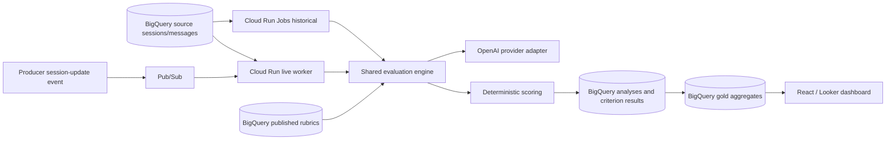

# Architecture and boundaries

### Live event contract
`{event_id, organization_id, workspace_id, session_id, source_updated_at, source_version}`. Events are emitted by the upstream ingestion pipeline *after* source data is queryable; dedupe and eventual consistency must be handled. Alternative: partition-pruned watermark scanner on Scheduler with overlap and checkpoints.

### Runtime isolation
Cloud Run services use dedicated service accounts. BigQuery row policies/authorized views can supplement but do not replace application tenant predicates. Separate billing/quotas per tenant in application accounting.

### State
BigQuery is analytical, not a low-latency transactional queue. Use Pub/Sub for delivery; for debounce consider Cloud Tasks named tasks or lightweight external state, benchmark before choosing. No unbounded MERGE per message. Use append-only output + deduplicated latest views.
