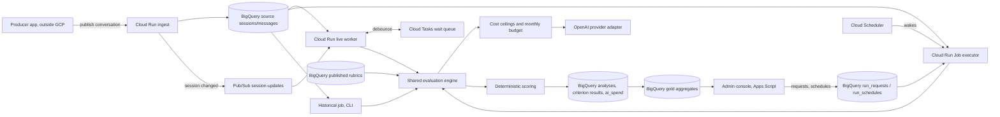

# Architecture and boundaries

### Live event contract
`{event_id, organization_id, workspace_id, session_id, source_updated_at, source_version}`. Events are emitted by the upstream ingestion pipeline *after* source data is queryable; dedupe and eventual consistency must be handled. Alternative: partition-pruned watermark scanner on Scheduler with overlap and checkpoints.

### Runtime isolation
Cloud Run services use dedicated service accounts. BigQuery row policies/authorized views can supplement but do not replace application tenant predicates. Separate billing/quotas per tenant in application accounting.

### State
BigQuery is analytical, not a low-latency transactional queue. Use Pub/Sub for delivery; for debounce consider Cloud Tasks named tasks or lightweight external state, benchmark before choosing. No unbounded MERGE per message. Use append-only output + deduplicated latest views.

## The live path as implemented (verified in dev, 2026-11-01)
1. **Producer** (outside this repository: the upstream ingestion pipeline, or the conversation ingest service after it stores a conversation) publishes a `SessionUpdateEvent` (`contracts/session-update.schema.json`) to the Pub/Sub topic `sci-dev-session-updates`, after the data is queryable. BigQuery row-insert events are never assumed.
2. **Push subscription** (OIDC token of a dedicated identity) delivers it to the Cloud Run service `/pubsub/push`. The worker verifies the token, validates the event (malformed: 400), answers 503 while AI is off, rejects a tenant that is not in the allowlist (403), and **schedules a Cloud Tasks task** named from tenant + session + the window of `source_updated_at` (a repeated event for the same version of the session creates no new task: debounce and idempotency in one). Failed deliveries are retried 5 times and then parked in the dead-letter hold (7 days).
3. **Cloud Tasks queue** (5 dispatches/s, 5 concurrent, 8 attempts, backoff 10 to 300 s) calls `/tasks/evaluate` after the wait (60 s in dev, 120 s by default).
4. **Evaluation** (`LiveProcessor`): loads the published rubric (or routes the session to one), reads only that session from BigQuery (bounded, tenant-filtered; "source behind the event" becomes a retry), **skips an unchanged content** (hash against the stored analyses, no AI cost: `DUPLICATE_CONTENT`), applies the per-session rate limit and the **monthly budget** (month-to-date spend from the ledger plus the worst case of this call), calls the engine (OpenAI, model from the closed catalog), and **writes the analysis and the criteria** to BigQuery (load jobs, deterministic job ids). Every handled event leaves a row in `analysis_runs` with its outcome (`EVALUATED`, `DUPLICATE_CONTENT`, `BUDGET_BLOCKED`, `RATE_LIMITED`, `TOKEN_LIMIT`, `NO_MESSAGES`, `SESSION_NOT_FOUND`, `ROUTED_SKIP`); failures go to `run_failures`.
5. **Observability**: structured logs (`event_scheduled`, `evaluation`, `live_event`, `task_retry`), alert policies for failures, latency, dead letters and the oldest unacknowledged message.

Spend and the monthly cap: every paid call is recorded in `ai_spend` the moment the provider answers (before the result is scored or stored) and the cap reads that table, so a call whose result is never stored (failed write, a concurrent twin) still counts. A retry after a failed write still pays again, and two racing evaluations of the same content still both pay; both are now visible in the record.

The console's "Como funciona" diagram draws exactly these components (event, worker, wait queue, console executor, historical job, engine, cost ceiling, AI, results); the state of the live nodes is computed from the `analysis_runs` rows above.

## Conversation ingest (deployed in dev)
Producers publish conversations to `sci-<env>-conversations`; a Cloud Run service validates them (contract, tenant allowlist, dates), stores them in the canonical BigQuery tables idempotently (a session only moves forward, a message is stored once however often it is sent) and publishes the analysis event consumed by the live path above. A producer outside Google Cloud authenticates with the service account `sci-<env>-producer` (publish on that one topic only; its key is created by a person, never by Terraform). Rules and producer guide: `docs/ingest.md`, `docs/producer-guide.md`. Without the ingest, conversations must reach `commerce.sessions` and `commerce.messages` by some other means before an event is published.

## Requests, schedules and the executor (deployed in dev)
An administrator asks for a run in the console (a request with a cost ceiling) or defines a recurring schedule; both are rows of BigQuery tables the console writes and the platform runs without. A Cloud Run Job, woken by Cloud Scheduler, turns the schedules that are due into ordinary requests (exactly one per slot) and runs the waiting ones under its own gates: the request validated again, the requester still an active ADMIN, the monthly AI budget of the workspace (from the `ai_spend` ledger) and the job's preflight and budget gate. Details: `docs/scheduling.md`.
